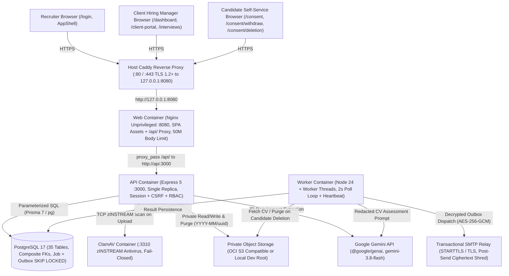
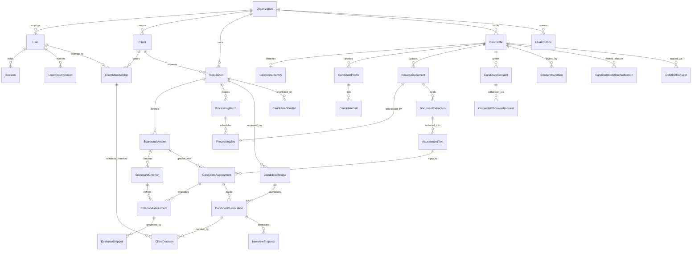

# TalentLens AI — Technical Design Document

- **Documentation verified:** November 10, 2026
- **Repository:** https://github.com/Lokaprathap22/TalentLens-Ai
- **Production URL:** https://talentlens-ai.duckdns.org
- **Verified Release Archive:** `TalentLens-AI-FINAL-RELEASE-AUDIT.zip` (`SHA-256: 45bda13bc6b4a6d1a037084320786771b2382f2cebfe7562b1b778fcedee31f2`)

> [!IMPORTANT]
> **Production Verification Status (November 10, 2026)**
>
> The audited release archive is deployed on OCI Ubuntu 24.04 with all 14 Prisma migrations applied, all five runtime containers (`talentlens-web`, `talentlens-api`, `talentlens-worker`, `talentlens-postgres`, `talentlens-clamav`) healthy, host Caddy HTTPS active, `GET /` returning HTTP 200, `GET /api/v1/health/ready` returning `{"status":"ready","database":"connected"}`, and existing recruiter login, dashboard access, and preserved tenant/client/requisition records verified.
>
> End-to-end production smoke tests for **resume upload/OCR/AI assessment** and the **complete client hiring-manager portal workflow** remain **pending** in production and are explicitly separated from pre-deployment automated test results in [Section 16](#16-testing-strategy).

---

## Table of Contents

1. [Executive Summary](#1-executive-summary)
2. [Problem Statement](#2-problem-statement)
3. [System Objectives](#3-system-objectives)
4. [Technology Stack](#4-technology-stack)
5. [System Architecture](#5-system-architecture)
6. [Repository Architecture](#6-repository-architecture)
7. [Frontend Architecture](#7-frontend-architecture)
8. [Backend Architecture](#8-backend-architecture)
9. [Database Design](#9-database-design)
10. [Resume Processing Pipeline](#10-resume-processing-pipeline)
11. [AI Assessment Architecture](#11-ai-assessment-architecture)
12. [Consent and Privacy Architecture](#12-consent-and-privacy-architecture)
13. [Email/Background Processing](#13-emailbackground-processing)
14. [Storage and Security](#14-storage-and-security)
15. [API Overview](#15-api-overview)
16. [Testing Strategy](#16-testing-strategy)
17. [Deployment Architecture](#17-deployment-architecture)
18. [Limitations and Future Improvements](#18-limitations-and-future-improvements)

---

## 1. Executive Summary

TalentLens AI is a multi-tenant, human-in-the-loop recruitment screening and client shortlist platform implemented as a TypeScript npm-workspaces monorepo (`Node.js 24`, `React 19`, `Express 5`, `PostgreSQL 17`, `Prisma 7`). It supports staffing firms from job description (JD) intake through candidate consent, CV parsing/OCR, evidence-grounded AI assessment via Google Gemini, recruiter shortlist curation, masked client portal review, and interview scheduling.

The platform is engineered around three core invariants:

1. **Human Control Over AI Decisions:** AI extracts draft scorecard criteria (`DRAFT -> APPROVED -> ARCHIVED`) and scores resumes only against recruiter-approved criteria using verifiable verbatim evidence snippets. Incomplete, conflicting, or unverified criteria always force `overallScore = null` and `AssessmentStatus.NEEDS_REVIEW`, and AI outputs never reject a candidate automatically.
2. **Fail-Closed Document, Auth, and Outbox Security:** Untrusted PDF and DOCX files are bounded at HTTP/multipart ingress, scanned via ClamAV (`zINSTREAM`), stored under opaque keys, parsed in isolated worker threads with strict decompression and Poppler/Tesseract geometry caps, and assessed after deterministic PII redaction (`2026-11-redactor-v2`). Passwords use Argon2id, sessions and security tokens store SHA-256 digests, and queued transactional emails are encrypted at rest with AES-256-GCM before post-send ciphertext shredding.
3. **Database-Enforced Tenant and Lineage Integrity:** PostgreSQL composite foreign keys bind child rows (`ClientMembership`, `Requisition`, `ScorecardVersion`, `ResumeDocument`, `DocumentExtraction`, `AssessmentText`, `CandidateAssessment`, `CandidateSubmission`, `ClientDecision`) to matching `(organizationId, ...)` ancestors so cross-tenant or mismatched-version attachments fail at the schema level as well as in application services.

---

## 2. Problem Statement

Staffing teams operating high-volume contract and permanent hiring workflows face four structural operational problems:

- **Manual CV Screening Bottlenecks:** Evaluating large applicant batches against shifting job requirements across recruiters introduces inconsistent grading, missed qualifications, and slow time-to-shortlist.
- **Uncontrolled Shortlist Sharing:** Circulating candidate spreadsheets and raw CV attachments over ad hoc email channels leaks direct candidate phone numbers/emails to clients prematurely, fragments client feedback, and loses interview scheduling audit trails.
- **Untrusted File & Prompt Surfaces:** Accepting arbitrary candidate PDF and DOCX files in web applications introduces ZIP/FLATE decompression bombs, oversized raster OCR DoS vectors (`pdftoppm`/Tesseract memory exhaustion), malware uploads, path traversal risks, and indirect prompt injection embedded in resume prose.
- **Privacy & Consent Governance Gaps:** Processing and sharing candidate profiles requires purpose-scoped consent invitations tied to exact notice text versions, self-service consent withdrawal, and atomic erasure guarantees covering database records, storage objects, and pending outbound emails.

TalentLens AI solves these problems by replacing ad hoc spreadsheets with structured scorecards, sandboxed parsing/OCR queues, redacted evidence-verified AI assessments, masked client shortlist workspaces, and enforceable consent/deletion state machines.

---

## 3. System Objectives

| Category                            | Engineering Objective                                                    | Implemented Mechanism                                                                                                                                                                    |
| :---------------------------------- | :----------------------------------------------------------------------- | :--------------------------------------------------------------------------------------------------------------------------------------------------------------------------------------- |
| **Explainable AI Screening**        | Require transparent, verifiable grounding for every criterion score      | Draft JD extraction (`PENDING_RECRUITER_REVIEW`), immutable `APPROVED` scorecard versions, `EXACT_QUOTE` / whitespace-normalized offset verification, and `weighted_criteria_v2` scoring |
| **Zero Autonomous Rejection**       | Ensure recruiters retain all pass/reject and client-submission authority | Manual `CandidateReview` (`REVIEWED`), `CandidateShortlist`, and `CandidateSubmission` gates; incomplete AI runs default to `NEEDS_REVIEW`                                               |
| **Strict Tenant & Role Isolation**  | Prevent cross-organization or cross-client data access                   | Server-derived `AuthenticatedPrincipal` (`userId`, `organizationId`, `role`), `requireClientMembership`, and PostgreSQL composite unique/foreign keys                                    |
| **Defense-in-Depth Upload Safety**  | Safely parse untrusted PDF and DOCX files at scale                       | Streaming multipart caps (`15 MB`/file, `50 MB`/request, `500` files / `1 GB` batch), magic bytes, `ClamAvScanner`, `inflateBounded`, `/ObjStm` expansion, Poppler/Tesseract limits      |
| **Consent & Erasure Compliance**    | Enforce active purpose-scoped consent and fail-closed deletion           | Pinned notice snapshots (`noticeTextHash`), hash-fragment public links, 24h withdrawal/deletion tokens, `verifyAndLockActiveCandidate`, S3 purge, and outbox erasure                     |
| **Reliable Transactional Delivery** | Guarantee at-most-once encrypted email dispatch without token leaks      | PostgreSQL `email_outbox` with HMAC `idempotency_key`, AES-256-GCM AAD encryption, `SKIP LOCKED` leases, exponential retry backoff, and post-send shredding                              |

---

## 4. Technology Stack

All versions and dependencies below are verified directly from [package.json](../package.json), workspace `package.json` manifests, Prisma configuration, Dockerfiles, and host deployment scripts.

| Layer                                                       | Technology / Library                                                                                                 | Exact Configured Version / Pin                                                                                                                                                                                             | Notes                                                                                                 |
| :---------------------------------------------------------- | :------------------------------------------------------------------------------------------------------------------- | :------------------------------------------------------------------------------------------------------------------------------------------------------------------------------------------------------------------------- | :---------------------------------------------------------------------------------------------------- |
| **Runtime**                                                 | Node.js / npm                                                                                                        | `>=24.11.0 <25` (Docker `node:24-alpine`)                                                                                                                                                                                  | Native TypeScript workspace compilation with `tsc` (`module: NodeNext`)                               |
| **Language & Validation**                                   | TypeScript, Zod                                                                                                      | `typescript ^5.9.3`, `zod ^4.1.12` (`@talentlens/shared`) / `^4.6.7` (`@talentlens/assessment-engine`)                                                                                                                     | Strict boundary validation across HTTP, env, and Gemini JSON payloads                                 |
| **Frontend (`@talentlens/web`)**                            | React, React DOM, React Router, Vite, Tailwind CSS, Lucide React, Fontsource Inter                                   | `react ^19.2.0`, `react-dom ^19.2.0`, `react-router ^8.5.1`, `vite ^8.0.0`, `@vitejs/plugin-react ^5.1.1`, `tailwindcss ^4.1.17`, `@tailwindcss/vite ^4.1.17`, `lucide-react ^1.68.0`, `@fontsource-variable/inter ^5.3.0` | Static SPA served via `nginxinc/nginx-unprivileged:alpine` (`8080`)                                   |
| **Backend API (`@talentlens/api`)**                         | Express, Helmet, `express-rate-limit`, Argon2, `dotenv`                                                              | `express ^5.1.0`, `helmet ^8.1.0`, `express-rate-limit ^8.7.3`, `argon2 ^0.45.2`, `dotenv ^17.2.3`                                                                                                                         | Single-replica Express API (`replicas: 1`) on internal port `3000`                                    |
| **Worker (`@talentlens/worker`)**                           | Node.js Worker Threads (`node:worker_threads`), `dotenv`, raw TCP/TLS `SmtpClient`                                   | Built-in Node 24 APIs + workspace libraries                                                                                                                                                                                | Isolated PDF/DOCX/OCR parsing, Gemini assessment runner, and email outbox dispatcher                  |
| **Database & ORM**                                          | PostgreSQL, Prisma Client, `@prisma/adapter-pg`, `pg`                                                                | `postgres:17-alpine`, `prisma ^7.10.1`, `@prisma/client ^7.10.1`, `@prisma/adapter-pg ^7.10.1`, `pg ^8.16.3`                                                                                                               | `previewFeatures = ["partialIndexes"]`; `prisma.config.ts` root config                                |
| **Document Processing (`@talentlens/document-processing`)** | Custom Node.js ZIP/PDF/FLATE engine + `@talentlens/document-processing`                                              | Zero external NPM parsing deps (`node:zlib` incremental inflate)                                                                                                                                                           | Bounded DOCX XML extractor, PDF `/ObjStm` parser, header image dimension inspector                    |
| **OCR Runtime**                                             | Tesseract OCR (`eng`), Poppler Utilities (`pdfinfo`, `pdftoppm`)                                                     | Alpine packages `tesseract-ocr`, `tesseract-ocr-data-eng`, `poppler-utils` (`apps/worker/Dockerfile`)                                                                                                                      | `tesseract --oem 1 --psm 3 -l eng tsv`; `pdftoppm -png -cropbox -r 150 -f 1 -l 10`                    |
| **AI / LLM**                                                | Google Gemini SDK (`@google/genai`)                                                                                  | `@google/genai 3.0.0` (exact pin in `@talentlens/api` and `@talentlens/assessment-engine`)                                                                                                                                 | Default model `gemini-3.8-flash`, 30s default HTTP timeout, structured `responseSchema`               |
| **Object Storage**                                          | Custom AWS SigV4 S3 Client (`node:crypto` + `fetch`) / Local Disk (`LocalDocumentStorageService`)                    | Built-in `apps/api/src/modules/resumes/resume.storage.ts` & `apps/worker/src/storage.ts`                                                                                                                                   | OCI Object Storage S3 Compatibility API (`AES256`, path-style configurable via `S3_FORCE_PATH_STYLE`) |
| **Antivirus**                                               | ClamAV daemon + `zINSTREAM` TCP client                                                                               | `clamav/clamav:1.4` (`docker-compose.prod.yml` / `docker-compose.prod-test.yml`)                                                                                                                                           | Fail-closed TCP chunk streaming (`64 KB` chunks, port `3310`)                                         |
| **Reverse Proxy & TLS**                                     | Nginx (container) + Caddy (host VM)                                                                                  | `nginxinc/nginx-unprivileged:alpine` (`apps/web/Dockerfile`); Host Caddy (`scripts/setup-caddy.sh`)                                                                                                                        | Caddy terminates TLS (`:80/:443`) -> `127.0.0.1:8080` -> Nginx -> `api:3000`                          |
| **Testing & Code Quality**                                  | Vitest, Supertest, Testing Library (`react`, `jest-dom`, `user-event`), `jsdom`, Playwright, ESLint, Prettier, `tsx` | `vitest ^4.0.8` (`^4.1.12` web), `supertest ^7.1.4`, `@testing-library/react ^16.3.3`, `@testing-library/jest-dom ^7.0.1`, `jsdom ^30.1.3`, `@playwright/test ^1.65.0`, `eslint ^9.39.1`, `prettier ^3.6.2`, `tsx ^4.20.6` | Unit, API integration, React UI tests, Playwright E2E, Node `node --test` guard suites                |

---

## 5. System Architecture

The runtime topology separates public edge TLS termination (`Caddy`), static SPA hosting and `/api/` reverse proxying (`Nginx`), stateless-cookie HTTP API handling (`Express API`), asynchronous CPU/I/O-heavy processing (`Worker`), relational persistence (`PostgreSQL 17`), malware scanning (`ClamAV`), private resume binary storage (`OCI S3` or local storage in dev), LLM inference (`Google Gemini`), and transactional email dispatch (`SMTP`).

### Runtime Boundary Flow

1. All browser requests arrive over HTTPS at host Caddy, which forwards `127.0.0.1:8080` to the `web` Nginx container with `X-Forwarded-For`, `X-Forwarded-Proto`, and `Host` headers preserved (`deploy.sh` / `scripts/setup-caddy.sh`).
2. `web` serves immutable static Vite assets (`/` -> `index.html`) and proxies `/api/*` internally over Docker networking to `api:3000` (not published to host ports).
3. `api` handles synchronous HTTP endpoints: auth/sessions, RBAC, requisition/scorecard management, JD extraction via Gemini, bounded multipart resume upload + synchronous structure pre-validation + ClamAV scanning + S3 storage + DB transaction creation, client portal actions, and consent/deletion endpoints. Notice that transactional emails are enqueued inside PostgreSQL transactions into `email_outbox` rather than blocking HTTP responses on external SMTP sockets.
4. `worker` polls `processing_jobs` and `email_outbox` every `2000ms`, claiming rows with atomic `FOR UPDATE SKIP LOCKED` leases, running PDF/DOCX extraction and Poppler/Tesseract OCR inside `node:worker_threads`, calling Gemini only against PII-redacted text for candidates with `ACTIVE` consent, and dispatching decrypted emails via SMTP before shredding plaintext/ciphertext columns.

---

## 6. Repository Architecture

The repository is structured as a unified TypeScript monorepo configured in root [package.json](../package.json):

| Workspace / Directory              | Package Name                      | Responsibilities                                                                                                                                                                                                                                                                                                                                                                                                                                     |
| :--------------------------------- | :-------------------------------- | :--------------------------------------------------------------------------------------------------------------------------------------------------------------------------------------------------------------------------------------------------------------------------------------------------------------------------------------------------------------------------------------------------------------------------------------------------- |
| **`apps/api`**                     | `@talentlens/api`                 | Express 5 application (`app.ts`, `server.ts`, `lifecycle.ts`), Zod env loader (`config/env.ts`), security middleware (`require-session`, `csrf`, `origin-protection`, `require-role`, `require-client-membership`, `require-submission-access`), domain modules (`auth`, `authorization`, `requisitions`, `scorecards`, `resumes`, `consent`, `assessments`, `workflow`, `email`), endpoint inventory test, and `apps/api/src/scripts/bootstrap.ts`. |
| **`apps/web`**                     | `@talentlens/web`                 | React 19 + Vite 8 + Tailwind CSS v4 frontend (`App.tsx`, `app/`, `components/ui/`, `layouts/`, `lib/api-client.ts`, `dev-fixtures/`), Nginx reverse-proxy configuration (`nginx.conf`), and 11 domain feature folders (`auth`, `candidates`, `client-portal`, `clients`, `consent`, `dashboard`, `design-system`, `interviews`, `requisitions`, `scorecards`, `settings`).                                                                           |
| **`apps/worker`**                  | `@talentlens/worker`              | Standalone Node.js background processor (`index.ts`), `WorkerJobProcessor` (`processor.ts`), `WorkerEmailDispatcher` (`email-dispatcher.ts`), worker-side AES-256-GCM outbox crypto (`email-crypto.ts`), `SmtpClient` (`smtp-client.ts`), S3/local binary fetcher (`storage.ts`), and readiness/Docker healthcheck probe (`readiness.ts`, `healthcheck.ts`).                                                                                         |
| **`packages/shared`**              | `@talentlens/shared`              | Shared Zod DTOs, enums, role types, requisition/health contracts consumed across `@talentlens/api`, `@talentlens/web`, and worker modules.                                                                                                                                                                                                                                                                                                           |
| **`packages/database`**            | `@talentlens/database`            | Prisma Client wrapper (`src/client.ts`) using `@prisma/adapter-pg` and `pg.Pool`, schema-generated TypeScript models (`src/generated/prisma/`), and clean `disconnectDatabase()` lifecycle helper.                                                                                                                                                                                                                                                   |
| **`packages/document-processing`** | `@talentlens/document-processing` | Zero-external-parser bounded binary engine (`decompress.ts`, `docx.ts`, `pdf.ts`, `image-limits.ts`, `ocr.ts`, `parser.ts`, `errors.ts`, `types.ts`) enforcing inflation limits, ZIP EOCD matching, `/ObjStm` object-stream decoding, and Poppler/Tesseract image geometry guards.                                                                                                                                                                   |
| **`packages/assessment-engine`**   | `@talentlens/assessment-engine`   | Prompt-isolated `@google/genai` provider (`provider.ts`), deterministic offset-preserving PII redactor (`redactor.ts`), verbatim quote verifier (`verifier.ts`), weighted scorer (`scoring.ts`), and shared types.                                                                                                                                                                                                                                   |
| **`prisma/`**                      | _(root)_                          | Authoritative `schema.prisma` (35 models, 36 enums) and 14 immutable PostgreSQL SQL migrations (`prisma/migrations/*`).                                                                                                                                                                                                                                                                                                                              |
| **`scripts/`**                     | _(root)_                          | Operational automation: `preflight-env.mjs`, `generate-secrets.mjs`, `setup-caddy.sh`, `backup.sh`, `backup.ps1`, `restore.sh`, `restore.ps1`; and verification tooling: `e2e-safety-guard.mjs`, `e2e-safety-guard.test.mjs`, `run-browser-e2e.mjs`, `visual-qa.mjs`, `test-gemini-live.mjs`, `test-s3-tenant-isolation.mjs`, `test-smtp-lifecycle.mjs`.                                                                                             |
| **`docs/` & Root Files**           | _(root)_                          | `README.md`, `deployment.md`, `deploy.sh`, `docker-compose.yml`, `docker-compose.prod.yml`, `docker-compose.prod-test.yml`, `docs/TECHNICAL_DESIGN_DOCUMENT.md`, `docs/OPERATOR_RUNBOOK.md`, `docs/DATABASE_INTEGRITY.md`, `docs/TECHNICAL_SPEC.md`.                                                                                                                                                                                                 |

---

## 7. Frontend Architecture

The frontend (`@talentlens/web`) is built with React `^19.2.0`, TypeScript `^5.9.3`, Vite `^8.0.0`, Tailwind CSS `^4.1.17`, and React Router `^8.5.1`.

### 7.1 Routing & Role Access Control

Routes are defined declaratively in [apps/web/src/App.tsx](../apps/web/src/App.tsx) using `<BrowserRouter>` and protected via `<AuthProvider>` (`apps/web/src/app/auth.tsx`) and `<ProtectedRoute>` (`apps/web/src/app/protected-route.tsx`):

- **Public Routes:**
  - Auth lifecycle: `/login`, `/activate`, `/reset-password`
  - Candidate privacy self-service: `/consent`, `/consent/withdraw`, `/consent/deletion` (sensitive bearer tokens are read strictly from `window.location.hash` fragments, never query parameters, and immediately submitted via POST).
- **Authenticated Role-Scoped Workspaces:**
  - **`CLIENT_HIRING_MANAGER`:** `/client-portal` (`ClientPortalPage`), `/dashboard` (`DashboardPage`), `/interviews` (`InterviewsPage`).
  - **`DELIVERY_HEAD`:** `/delivery-overview` (`RoleWorkspaceNoticePage` — documented read-only placeholder notice; analytics dashboard deferred).
  - **`RECRUITER`:** Wrapped in `<AppShell>` (`apps/web/src/layouts/AppShell.tsx`) for `/dashboard`, `/clients`, `/clients/:clientId`, `/requisitions`, `/requisitions/:requisitionId`, `/scorecards`, `/candidates`, `/requisitions/:requisitionId/candidates`, `/requisitions/:requisitionId/candidates/:candidateId`, `/requisitions/:requisitionId/scorecards`, `/requisitions/:requisitionId/scorecards/:versionId`, `/interviews`, `/settings`, and fallback `*` (`NotFoundPage`).
- **Dev/Test Only Preview Routes:** `/dev/preview/*` and `/design-system` are conditionally mounted only when `import.meta.env.DEV || import.meta.env.MODE === 'test'`, preventing fixture exposure in production builds.

### 7.2 Feature Modules & Component Organization

All domain views live in `apps/web/src/features/` (`auth`, `candidates`, `client-portal`, `clients`, `consent`, `dashboard`, `design-system`, `interviews`, `requisitions`, `scorecards`, `settings`), supported by reusable accessible UI primitives in `apps/web/src/components/ui/` (`avatar`, `badge`, `breadcrumbs`, `button`, `card`, `data-table`, `dialog`, `dropdown-menu`, `form-controls`, `icon`, `icon-button`, `pagination`, `search-field`, `states`, `status-badge`, `tabs`, `tooltip`, plus `brand.tsx`). `layouts/PageHeader.tsx` and `layouts/AppShell.tsx` standardize page headers, navigation rails (`app/navigation.ts`), and workspace state (`app/workspace.tsx`).

### 7.3 API Client & State / Data-Fetching Patterns

Frontend HTTP communication is centralized in [apps/web/src/lib/api-client.ts](../apps/web/src/lib/api-client.ts):

- **Strict URL Normalization (`resolveApiUrl`):** Rejects protocol-relative URLs, backslashes, explicit schemes, `.` / `..` traversal segments, or accidental `/api` prefixes; prefixes all relative calls with `/api/v1`.
- **Cookie & Memory-Only CSRF Discipline:** Sends every request with `credentials: 'same-origin'`. Never reads or stores session or CSRF tokens in `localStorage`, `sessionStorage`, or non-HttpOnly cookies. For protected state-changing calls (`POST`, `PATCH`, `PUT`, `DELETE`), if module-memory `csrfTokenInMemory` is empty, `fetchCsrfToken()` performs a single-flight `GET /api/v1/auth/csrf` and attaches `x-csrf-token` (exempting only the public unauthenticated auth and candidate-consent POST endpoints).
- **Session Expiry & Safe Error Mapping:** HTTP `401` on protected endpoints clears `csrfTokenInMemory` and invokes `unauthorizedHandler` (triggering auth state reset); `parseErrorResponse` strips multi-line stack traces or Prisma diagnostics and maps status/error codes to user-safe `ApiError` instances.
- **Data Fetching Pattern:** Components fetch domain DTOs directly through typed feature/API hooks with `AbortController` cleanup, `FormData` upload handling (allowing the browser to set multipart boundaries automatically), and explicit loading/empty/error UI states via `components/ui/states.tsx`.

---

## 8. Backend Architecture

The HTTP API (`@talentlens/api`) exposes a single-process Express 5 server wired in [apps/api/src/server.ts](../apps/api/src/server.ts) and assembled in [apps/api/src/app.ts](../apps/api/src/app.ts).

### 8.1 Layered Module Pattern

Each backend capability (`auth`, `requisitions`, `scorecards`, `resumes`, `consent`, `assessments`, `workflow`, `authorization`, `email`) separates:

1. **Routes (`*.routes.ts`):** Express routers defining URL paths, parameter UUID validation (`z.string().uuid()`), middleware chains (`requireSession`, `requireRole`, `requireSameOrigin`, `requireCsrf`, `requireClientMembership`), per-route rate limiters, and HTTP error translation.
2. **Schemas & DTOs (`*.schemas.ts`, `*.dto.ts`):** Strict Zod boundary parsing and explicit projection interfaces — raw Prisma records are never returned directly to callers.
3. **Services (`*.service.ts`):** Business rules, transition validation, consent/review preconditions, provider orchestration, and domain error classes.
4. **Repositories (`*.repository.ts`):** Scoped Prisma queries enforcing `organizationId` and `assignedRecruiterId` filters and atomic `$transaction` writes.

### 8.2 Middleware, Authentication, Authorization & Security Controls

- **Startup Environment & Crypto Validation:** `loadEnvironment()` (`apps/api/src/config/env.ts`) parses and validates required variables via Zod; `initializeIdempotencySecret()` and `initializeKeyRing()` execute at boot in `server.ts` so missing production keys fail immediately before listening.
- **Password & Token Security:**
  - `hashPassword` / `verifyPassword` (`password.service.ts`): Argon2id (`memoryCost: 19456` KiB, `timeCost: 2`, `parallelism: 1`, `hashLength: 32`). Login performs a dummy Argon2 verify against `DUMMY_PASSWORD_HASH` for unknown emails/unactivated users to prevent timing enumeration.
  - `SessionService`: Generates 32 random bytes (`base64url`), stores SHA-256 digest in `sessions`, sets `__Host-talentlens_session` (`HttpOnly; Path=/; SameSite=Lax; Secure` in production; `talentlens_session` over local HTTP) with an `8 hour` TTL (`SESSION_TTL_MS`).
  - `SecurityTokenService`: Issues 48h `ACTIVATION` tokens and 1h `PASSWORD_RESET` tokens as SHA-256 digests (`user_security_tokens`) with single-use `consumedAt` conditional updates.
- **CSRF & Same-Origin Protection:**
  - `createRequireSameOrigin(APP_ORIGIN)` requires an exact `Origin` header match for authenticated mutations and login/activation/password-reset endpoints (`403 request_not_allowed` on mismatch).
  - `requireCsrf` verifies `x-csrf-token` against `HMAC-SHA256(rawSessionToken, "talentlens-auth-csrf-v1")` in constant time (`timingSafeEqual`).
- **Role & Tenant Isolation:**
  - `createRequireRole([...])` restricts endpoints by server-derived `principal.role` (`RECRUITER`, `CLIENT_HIRING_MANAGER`, `DELIVERY_HEAD`).
  - `createRequireClientMembership` verifies active `ClientMembership` inside the same `organizationId` for all `/clients/:clientId/*` routes.
  - Recruiter endpoints derive `organizationId` and `userId` strictly from `response.locals.authPrincipal` (populated from `Session`), never from request bodies or params.
- **Global & Route Limits:**
  - `helmet()` security headers enabled and `x-powered-by` disabled.
  - Global JSON body limit `100kb` (with auth JSON routes tightening to `20kb`, and multipart resume uploads handled by raw stream parsing via `parseMultipartUpload`).
  - Proxy trust configured via `createTrustProxyEvaluator(trustedProxyIps, maxHops = 2)` supporting CIDR blocks, loopback, and hop depth caps.
  - Process-local `express-rate-limit` instances (15-minute windows): `10` requests on `/auth/login`, `/auth/activate`, `/auth/password/reset/{request,confirm}`, `30` on `/consent/inspect`, `15` on `/consent/{accept,decline,withdraw/confirm,deletion/confirm}`, and `10` on `/consent/{withdraw,deletion}/request`. Because limiters are in-memory, `docker-compose.prod.yml` pins `api` to `replicas: 1`.
- **Health & Error Handling:**
  - `GET /api/v1/health` (alias `/api/health`) returns static process liveness.
  - `GET /api/v1/health/ready` (alias `/api/health/ready`) executes `SELECT 1` against PostgreSQL and returns `200` (`ready`) or `503` (`not_ready`).
  - Unmatched `/api/*` paths return JSON `404 { error: 'not_found' }`; malformed JSON returns `400 { error: 'invalid_json' }`; unhandled exceptions return `500 { error: 'internal_error' }` with zero stack traces or HTML error pages.

---

## 9. Database Design

PostgreSQL 17 with Prisma 7 (`previewFeatures = ["partialIndexes"]`) stores all state in `prisma/schema.prisma`, comprising **35 models** and **36 enums** across 14 versioned migrations.

### 9.1 Core Models Summary

| Domain                                 | Models in `prisma/schema.prisma`                                                                                                                                                        | Key Responsibilities & Constraints                                                                                                                                                                                                                                                                                       |
| :------------------------------------- | :-------------------------------------------------------------------------------------------------------------------------------------------------------------------------------------- | :----------------------------------------------------------------------------------------------------------------------------------------------------------------------------------------------------------------------------------------------------------------------------------------------------------------------- |
| **Tenancy, Auth & Clients**            | `Organization`, `User`, `Client`, `ClientMembership`, `Session`, `UserSecurityToken`                                                                                                    | Unique `normalizedName` per org, `normalizedEmail` per org, SHA-256 `tokenHash` sessions/activation/reset tokens, client-manager memberships                                                                                                                                                                             |
| **Requisitions & Scorecards**          | `Requisition`, `ScorecardVersion`, `ScorecardCriterion`                                                                                                                                 | Org- and client-scoped jobs (`DRAFT/OPEN/PAUSED/CLOSED/FILLED`); immutable versioned scorecards (`@@unique([requisitionId, version])`); ordered active criteria                                                                                                                                                          |
| **Candidates, Profiles & Documents**   | `Candidate`, `CandidateIdentity`, `CandidateProfile`, `CandidateSkill`, `ResumeDocument`, `DocumentExtraction`, `AssessmentText`                                                        | `recordStatus` lifecycle (`ACTIVE`, `DELETION_PENDING`, `DELETED`); PII split into `CandidateIdentity` (`identityStatus`) and versioned `CandidateProfile`; org-scoped `sha256` unique constraint (`[organizationId, candidateId, sha256]`) and immutable extracted vs redacted text versions                            |
| **Processing & Async Queues**          | `ProcessingBatch`, `ProcessingJob`, `EmailOutbox`                                                                                                                                       | Batch upload/finalize state (`isOpen`, `totalFiles`, `cumulativeBytes`); typed lease-locked worker jobs (`VALIDATE_FILE`, `EXTRACT_TEXT`, `OCR`, `EXTRACT_PROFILE`, `DETECT_DUPLICATE`, `ASSESS_CANDIDATE`); AES-256-GCM encrypted `email_outbox` with `leaseToken`/`leaseExpiresAt` and HMAC `idempotencyKey`           |
| **Assessments, Workflow & Interviews** | `CandidateAssessment`, `CriterionAssessment`, `EvidenceSnippet`, `CandidateReview`, `CandidateShortlist`, `CandidateSubmission`, `ClientDecision`, `InterviewProposal`, `PipelineEvent` | Weighted scoring tied to exact scorecard/extraction/assessment-text tuple; verified evidence snippets (`EXACT_QUOTE`); partial unique index preventing duplicate active submissions; membership-locked `ClientDecision`; bidirectional `InterviewProposal`; append-only `PipelineEvent` timeline                         |
| **Consent, Deletion & Audit**          | `CandidateConsent`, `ConsentInvitation`, `OrganizationConsentPolicy`, `ConsentWithdrawalRequest`, `CandidateDeletionVerification`, `DeletionRequest`, `AuditLog`                        | Notice snapshot pinning (`noticeTextHash`, `noticeText`), partial unique index guaranteeing at most one `ACTIVE` hiring consent per `(organizationId, candidateId, requisitionId, purpose)`, single pending `CandidateDeletionVerification` partial unique index, recruiter `DeletionRequest`, and org-scoped `AuditLog` |

_(Full 36-enum reference spans `UserRole`, `UserStatus`, `UserSecurityTokenType`, `ClientStatus`, `MembershipRole`, `MembershipStatus`, `RequisitionStatus`, `ScorecardStatus`, `CriterionCategory`, `RequirementType`, `CandidateRecordStatus`, `IdentityStatus`, `ResumeParseStatus`, `FileType`, `ExtractionQualityStatus`, `ProcessingBatchStatus`, `ProcessingJobType`, `ProcessingJobStatus`, `AssessmentStatus`, `CriterionAssessmentStatus`, `VerificationMethod`, `ReviewDecision`, `SubmissionStatus`, `ClientDecisionType`, `InterviewFormat`, `InterviewProposalStatus`, `PipelineStage`, `ConsentPurpose`, `ConsentStatus`, `ConsentCaptureMethod`, `ConsentInvitationStatus`, `InvitationDeliveryStatus`, `WithdrawalRequestStatus`, `CandidateDeletionVerificationStatus`, `DeletionRequestStatus`, and `EmailDeliveryStatus`.)_

### 9.2 Entity-Relationship Diagram

The diagram below reflects exact primary model relationships from `prisma/schema.prisma`:

### 9.3 Organization-Level Isolation & Composite Foreign Keys

Almost every table uses `onDelete: Restrict` and declares compound unique keys (`@@unique([id, organizationId])` or wider lineage keys) referenced by child models:

- **Cross-Tenant Tamper Resistance:** Even if an attacker or buggy service passed a valid UUID from Tenant B into a Tenant A write, PostgreSQL rejects the foreign key because `(childId, organizationId)` must match the parent's `organizationId` simultaneously.
- **Lineage & Version Binding:**
  - `Requisition` carries `@@unique([id, clientId, organizationId])`, preventing a `CandidateSubmission` from attributing a client `C2` to a requisition owned by client `C1`.
  - `AssessmentText` defines `@@unique([id, resumeDocumentId, organizationId, documentExtractionId])`, referenced by both `CandidateAssessment` and `EvidenceSnippet`, proving AI outputs and highlighted evidence came from the exact redacted text version produced from that extraction.
  - `CandidateSubmission` enforces composite foreign keys to `(assessmentId, candidateId, requisitionId, resumeDocumentId)`, `(reviewId, candidateId, requisitionId, resumeDocumentId)`, and `(resumeDocumentId, candidateId, organizationId)` — preventing submissions with stale assessments or unreviewed CV versions.
  - `ClientDecision` binds `(membershipId, clientId, clientUserId, organizationId)` to `ClientMembership`, enforcing client-member attribution at the database layer.
- **Concurrency & Idempotency Partial Indexes:**
  - `candidate_submissions_active_scope_unique_idx`: partial unique index ensuring only one non-`WITHDRAWN` and non-`CLIENT_REJECTED` submission per `(requisitionId, candidateId)`.
  - `candidate_consents_active_scope_unique_idx`: partial unique index (`WHERE status = 'ACTIVE' AND requisition_id IS NOT NULL`) guaranteeing single active requisition consent per candidate.
  - `candidate_deletion_verifications_pending_unique_idx`: partial unique index (`WHERE status = 'PENDING'`) preventing flood generation of active candidate deletion verifications.

### 9.4 Prisma Migrations (All 14 Recorded Migrations)

| Purpose Group                                  | Migration Folder Name (Exact)                                            | Architectural Change Introduced                                                                                                                                     |
| :--------------------------------------------- | :----------------------------------------------------------------------- | :------------------------------------------------------------------------------------------------------------------------------------------------------------------ |
| **Core Schema & Composite Integrity**          | `20261103165807_init`                                                    | Initial 35-domain core schema (`organizations`, `users`, `clients`, `requisitions`, `scorecards`, `candidates`, `resumes`, `assessments`, `workflow`, `audit_logs`) |
|                                                | `20261104200000_schema_drift_composite_fks_resume_reuse`                 | Reconciles composite tenant foreign keys across extraction/assessment/submission lineage and supports cross-requisition resume reuse                                |
| **Worker Leases, Auth Gate & Security Tokens** | `20261104090000_worker_leases_and_auth_gate`                             | Adds lease columns (`lease_expires_at`, `locked_by`, `lease_token`), `HELD_FOR_AUTHORIZATION`, and authentication gating structures                                 |
|                                                | `20261108120000_user_security_tokens_and_profile_name`                   | Adds `user_security_tokens` (`ACTIVATION`, `PASSWORD_RESET`) and optional `users.name` profile column                                                               |
| **Workflow, Shortlisting & Interviews**        | `20261104160000_workflow_shortlist_history_interviews`                   | Adds `candidate_shortlists`, `interview_proposals`, and shortlist/interview history tracking                                                                        |
|                                                | `20261104183000_pipeline_stages_recruiter_shortlist_interview_completed` | Extends `PipelineStage` enum with `RECRUITER_SHORTLISTED` and `INTERVIEW_COMPLETED`                                                                                 |
| **Batch Intake Finalization**                  | `20261109050000_batch_intake_finalization_and_byte_counter`              | Adds `cumulative_bytes` and `is_open` to `processing_batches` for multi-request chunk finalization and cumulative 1 GB quota enforcement                            |
| **Consent Lifecycle, Notices & Deletion**      | `20261104110000_candidate_consent_lifecycle`                             | Adds `candidate_consents`, `consent_invitations`, `consent_withdrawal_requests`, and `deletion_requests` support                                                    |
|                                                | `20261104120000_candidate_consent_unique_active_scope`                   | Enforces partial unique index for active requisition-scoped candidate consents                                                                                      |
|                                                | `20261107030000_consent_notice_snapshots_and_org_policies`               | Adds `notice_text`, `notice_text_hash` notice snapshots, `confirmation_name`, and `organization_consent_policies`                                                   |
|                                                | `20261109080000_candidate_deletion_verifications`                        | Adds `candidate_deletion_verifications` table with partial unique `PENDING` constraint for self-service erasure verification                                        |
| **Persistent Encrypted Email Outbox**          | `20261106120000_persistent_email_outbox`                                 | Creates persistent `email_outbox` queue table with lease locking and retry metadata                                                                                 |
|                                                | `20261106130000_email_payload_encryption`                                | Adds `encrypted_payload` and `key_id` columns for AES-256-GCM at-rest encryption and nullable cleared plaintext fields                                              |
|                                                | `20261106140000_email_outbox_quarantine_legacy`                          | Quarantines legacy unencrypted `PENDING`/`SENDING` rows (`QUARANTINED_UNENCRYPTED_LEGACY`) and scrubs plaintext HTML/text columns                                   |

---

## 10. Resume Processing Pipeline

Resume ingestion and parsing implement a strict multi-stage defense-in-depth pipeline across `apps/api` and `apps/worker` (`@talentlens/document-processing`).

```mermaid
flowchart LR
    UP["1. Multipart Upload (<=50MB/req, 100 files, 15MB/file)"]
    VAL["2. Magic Bytes & Structure Pre-Validation (PDF / DOCX /ObjStm)"]
    AV["3. ClamAV zINSTREAM Scan (Fail-Closed)"]
    DEDUP["4. Batch + Org SHA-256 Deduplication"]
    STORE["5. Opaque Storage Save (YYYY-MM/uuid.ext, AES256)"]
    FIN["6. Batch Finalize (<=500 files, <=1GB)"]
    EXT["7. Worker Thread EXTRACT_TEXT / OCR (Poppler + Tesseract)"]
    PROF["8. EXTRACT_PROFILE & DETECT_DUPLICATE"]
    AI["9. ASSESS_CANDIDATE (Only if Active Consent + Approved Scorecard)"]

    UP --> VAL --> AV --> DEDUP --> STORE --> FIN --> EXT --> PROF --> AI
```

### 10.1 Stage-by-Stage Execution & Resource Limits

1. **HTTP / Multipart Ingress & Chunk Finalization (`resume.routes.ts`, `resume.multipart.ts`, `resume.service.ts`):**
   - Nginx caps client HTTP request bodies at `50 MB`.
   - `parseMultipartUpload` streams incoming parts to temp files using strict caps per request (`100` files max per chunk in `uploadResumes`, `15 MB` max per individual file).
   - Magic bytes (`detectFileTypeFromMagicBytes`) accept only `%PDF` (`PDF`) or `PK\x03\x04` (`DOCX`).
   - Multi-request upload chunks append into an open `ProcessingBatch` (`isOpen = true`). Finalization (`POST .../batches/:batchId/finalize` or `isFinal=true` / `x-is-final: true`) validates cumulative batch quotas (**500 total files**, **1 GB cumulative bytes**), closes the batch (`isOpen = false`), and atomically queues `EXTRACT_TEXT` jobs.
2. **Synchronous Upload Pre-Validation (`resume.service.ts`):**
   - Before antivirus scanning or S3 persistence, `uploadResumes` runs `DocxTextExtractor.parse` or `PdfTextExtractor.parse` (without OCR) synchronously on each accepted upload to reject ZIP bombs, traversal paths, encrypted files, >200-page PDFs, malformed DEFLATE streams, `/ObjStm` bombs, or oversized page geometries before storing objects.
3. **Fail-Closed Malware Scanning (`resume.scanner.ts`):**
   - `ClamAvScanner` streams each validated buffer over TCP port `3310` to ClamAV using `zINSTREAM\0` in `64 KB` chunks (`10s` socket timeout).
   - On `INFECTED`, the file is rejected with the reported threat signature; on `ERROR` when `SCANNER_FAIL_CLOSED !== 'false'` or in `production`/`staging`, upload is fail-closed and rejected.
4. **Deduplication, Private Object Storage & Compensating Cleanup:**
   - Duplicate SHA-256 hashes inside the batch or existing active organization resumes are classified gracefully as `DUPLICATE` (including `P2002` DB race handling, which deletes the extra stored object).
   - Accepted uploads save under opaque keys (`YYYY-MM/<uuid>.pdf|docx`) via `LocalDocumentStorageService` or `S3DocumentStorageService` (`ServerSideEncryption: AES256`). If the batch DB transaction fails after S3 writes, compensating cleanup deletes all written objects, and temp files are removed in `finally`.
5. **Bounded Decompression (`packages/document-processing/src/decompress.ts`):**
   - `inflateBounded` decodes zlib or raw DEFLATE in `8192`-byte slices while continuously checking elapsed deadlines, maximum output bytes (**10 MB** per stream/entry, **25 MB** aggregate document output), and compression ratio thresholds (after `512` output bytes: **100:1** max for PDFs, **50:1** max for DOCX). Exceeding any limit destroys the stream immediately without allocating full output buffers.
6. **DOCX Security Validation (`packages/document-processing/src/docx.ts`):**
   - Rejects ZIP64 markers, encrypted ZIP entries (bit 0), compression methods other than `0` (stored) or `8` (DEFLATE), >`500` entries, control characters, absolute paths, `.`/`..` traversal segments, and duplicate `word/document.xml`.
   - Enforces consistency between Local File Headers, bit-3 Data Descriptors, Central Directory (CD) records, and End of Central Directory (EOCD) headers, ensuring no corrupt trailing data follows EOCD.
7. **PDF `/ObjStm` Parsing & Pre-Render Geometry Limits (`packages/document-processing/src/pdf.ts`, `image-limits.ts`):**
   - Rejects `/Encrypt`, >`25 MB` files (parser cap; upload cap is `15 MB`), >`200` pages, >`2000` streams, >`20,000` inspected dictionaries (`depth <= 64`), and >`25,000` indirect objects (`refDepth <= 16`).
   - Strips raw `stream...endstream` byte payloads before scanning dictionaries so stream data cannot spoof object definitions, while locating compressed PDF 1.5+ object streams (`/Type /ObjStm`).
   - Boundedly decompresses `/ObjStm` payloads, unpacks indirect object pairs up to budget limits, walks catalog/page-tree hierarchy to resolve every leaf page (including inherited `/MediaBox`, `/CropBox`, `/Rotate`), computes rendered pixel dimensions at `150 DPI` (`maxRasterDpi: 600`), and fails with `SecurityLimitExceededError` or `InvalidDocumentFormatError` if any page exceeds **`10,000 x 10,000` pixels**, **`25,000,000` pixels per page**, or **`75,000,000` aggregate rendered pixels** — guaranteeing oversized later pages hidden inside `/ObjStm` streams are caught before Poppler or Tesseract executes.
8. **OCR Fallback Limits (`packages/document-processing/src/ocr.ts`):**
   - Triggered when PDF extracted text is empty (`0` chars) or sparse (`< 100` chars with `/Image` or `/DCTDecode`), or queued as an `OCR` job when `extraction.qualityStatus === 'NEEDS_REVIEW'`.
   - Checks input size (`<= 15 MB`), runs `pdfinfo` (`5s` timeout) + `-box` per-page geometry verification against structural page counts (`<= 200` input pages, intersected CropBox/MediaBox bounds), rasterizes pages `1..10` via `pdftoppm -png -cropbox -r 150`, validates PNG `IHDR` headers and aggregate PNG disk bytes (`<= 50 MB` `maxTotalRasterBytes`) and cumulative pixel budget (`<= 75,000,000` px), then runs `tesseract <page> stdout -l eng --oem 1 --psm 3 tsv` under `15s/page` and `30s/doc` cumulative deadlines. Always deletes temporary OCR directories in `finally`.
9. **Worker Execution, Profile Extraction & Downstream Jobs (`apps/worker/src/processor.ts`):**
   - `EXTRACT_TEXT` / `OCR`: Claims job via `FOR UPDATE SKIP LOCKED` (`300s` lease, `60s` heartbeat renewing `leaseExpiresAt`), parses strictly inside `node:worker_threads` (`parseInWorkerThread` — zero main-thread fallback), saves versioned `DocumentExtraction`, updates `ResumeDocument.parseStatus`, and queues `EXTRACT_PROFILE`.
   - `EXTRACT_PROFILE`: Deterministically extracts candidate role, years of experience, location, notice period, summary, and skills (matching against `60` curated canonical skills) into `CandidateProfile` + `CandidateSkill`, then queues `DETECT_DUPLICATE`.
   - `DETECT_DUPLICATE`: Detects matching `sha256` across organization `ResumeDocument` rows (`AuditLog`), checks whether the requisition already has an `APPROVED` `ScorecardVersion`, and conditionally queues `ASSESS_CANDIDATE`.
   - Failure paths: Deterministic safety/format failures (`SecurityLimitExceededError`, `InvalidDocumentFormatError`, `EncryptedDocumentError`, `OcrRuntimeUnavailableError`, `DocumentProcessingTimeoutError` exceeding max attempts, or permanent AI config errors) transition jobs/batches deterministically without silent partial scoring (`HELD_FOR_AUTHORIZATION`, `RETRYABLE_FAILURE` up to 3 attempts, or terminal `FAILED` / `COMPLETED_WITH_ERRORS`).

---

## 11. AI Assessment Architecture

AI touches two bounded stages: recruiter JD-to-draft scorecard extraction in `apps/api`, and candidate CV scoring in `apps/worker` (`@talentlens/assessment-engine`).

### 11.1 Gemini Integration & Model Configuration

- **JD Extraction (`apps/api/src/modules/scorecards/jd-extraction.provider.ts`):** Calls Google Gemini (`@google/genai`, default `gemini-3.8-flash`, `30_000ms` timeout, up to 2 retries on `429`/5xx/timeout) with strict JSON `responseSchema`, explicitly instructing the model to treat the JD as untrusted data, ignore demographic/protected content (flagging it in `warnings`), copy exact source quotations, and label every extracted item `PENDING_RECRUITER_REVIEW`.
- **Candidate Assessment (`packages/assessment-engine/src/provider.ts`):** Uses `createAssessmentProvider()`:
  - **`NODE_ENV === 'production' | 'staging'`:** Fails closed (`AssessmentProviderNotConfiguredError`) unless `ASSESSMENT_PROVIDER` is explicitly set (e.g., `'gemini'`), and requires valid `GEMINI_API_KEY` + `GEMINI_MODEL`. Requests for `'fake'` throw `SECURITY_VIOLATION` outside `NODE_ENV === 'test'`.
  - **`GeminiAssessmentProvider`:** Wraps candidate redacted resume text inside `<untrusted_candidate_resume>...</untrusted_candidate_resume>` (sanitizing closing tags inside the input), sets explicit anti-injection & anti-demographic system instructions, records SHA-256 `inputHash` and `outputHash` plus token usage metadata (`ASSESSMENT_PROMPT_VERSION = '2026-11-gemini-v1'`), and enforces 1:1 criterion ID coverage across all active scorecard criteria via Zod (`providerOutputSchema`).
  - _(Implementation note: `apps/worker/src/processor.ts` currently persists a legacy metadata label `provider: 'openai-compatible'` inside `CandidateAssessment.modelMetadataJson` alongside the real `aiOutput.model` string; tracked in [Section 18](#18-limitations-and-future-improvements).)_

### 11.2 PII Redaction (`packages/assessment-engine/src/redactor.ts`)

Before AI scoring runs, `redactResumeText` (`redactorVersion = '2026-11-redactor-v2'`) performs 1:1 character-length and offset-preserving replacement (`[REDACTED_<TYPE>]` padded with `_`) so cited offsets in `AssessmentText.redactedText` remain identical to `DocumentExtraction.extractedText`:

- Redacted categories: `EMAIL`, `PHONE`, `URL`, `ADDRESS` (numbered street addresses, PO boxes, `STATE ZIP`, and known `candidateAddress`), `DATE_OF_BIRTH`, `DEMOGRAPHIC` (gender/sex, `Mr./Mrs./Ms./Miss` salutations, marital status, nationality/religion/caste declarations, explicit ages), `NAME` (known candidate names with tech stop-word exclusions such as `Java`, `Node`, `React`, `Cloud`, `Staff`), and `IDENTIFIER` (`candidateCode`, extra identifiers).
- `AssessmentText` stores `redactedText` and positional-only `redactionMapJson` (never storing the removed plaintext values) linked via composite FK to `(documentExtractionId, resumeDocumentId, organizationId)`.

### 11.3 Evidence Verification & Weighted Scoring (`verifier.ts`, `scoring.ts`)

1. **Quote Verification (`verifyCriterionAssessments`):** Every `MATCH` or `PARTIAL` criterion must contain at least one `evidenceQuotes` entry matching `AssessmentText.redactedText` verbatim, case-insensitively, or via whitespace-normalized regex mapping, resolving `(startOffset, endOffset, pageNumber)` with `verificationMethod = 'EXACT_QUOTE'`. If zero quotes verify, status downgrades to **`UNVERIFIED`** (`normalizedValue = null`).
2. **Weighted Scoring (`calculateAssessmentSummary`, `weighted_criteria_v2`):**
   - Validates strictly positive finite criterion weights (`validateScorecardCriterionWeights`) and valid `(minScore, maxScore)` bounds.
   - Normalized criterion score: `normalized_score = (score - min) / (max - min)` clamped to `[0.0, 1.0]`.
   - `NOT_FOUND`, `UNCERTAIN`, `UNVERIFIED`, and `NOT_ASSESSED` remain `null` (never coerced to `0`).
   - Assessment is `COMPLETE` if and only if **100%** of active criteria have verified numeric scores, zero criteria are `NOT_FOUND`/`UNCERTAIN`/`UNVERIFIED`, and all `MUST_HAVE` criteria are `MATCH`. Otherwise, **`status = 'NEEDS_REVIEW'` and `score = null`** — preventing partial evaluations from producing misleading rankings.
3. **Failure Handling:** Transient API errors retry up to 2 times in provider (`50ms * (attempt + 1)`) and up to job attempt limits (`RETRYABLE_FAILURE` in `ProcessingJob`), while missing config/auth failures mark `FAILED` cleanly without corrupting assessment history.

### 11.4 Fairness & AI Decision-Making Caveats

> [!WARNING]
> **Explicit AI Fairness Boundary**
>
> TalentLens AI **does NOT claim** that Gemini or any automated scoring step guarantees unbiased hiring decisions. Regex and profile-based redaction (`2026-11-redactor-v2`) intentionally avoids stripping ambiguous narrative text to preserve technical evidence (such as `AWS Route 53` or `Java 17`), meaning unstructured biographical narrative, proxy attributes (e.g., school/employer names, unlabelled graduation dates), or non-standard address formats may still remain in assessment inputs.

To mitigate downstream risk without overclaiming automation neutrality:

- Final screening, shortlisting, client submission, and hiring decisions remain strictly human-executed (`CandidateReview`, `CandidateShortlist`, `CandidateSubmission`, `ClientDecision`).
- Client feedback/rejection reasons undergo fairness checks (`apps/api/src/modules/workflow/feedback.fairness.ts`) blocking 7 explicit protected-attribute categories (`AGE`, `PREGNANCY_OR_FAMILY`, `GENDER_OR_SEX`, `RACE_OR_ETHNICITY`, `RELIGION_OR_FAITH`, `DISABILITY_OR_HEALTH`, `SEXUAL_ORIENTATION`).

---

## 12. Consent and Privacy Architecture

Privacy and data governance controls span `apps/api/src/modules/consent/`, `apps/api/src/modules/workflow/`, and `apps/worker/`:

- **Consent Invitations & Policy Notice Pinning:**
  - Recruiters trigger requisition-scoped consent invitations (`POST /api/v1/requisitions/:requisitionId/candidates/:candidateId/consent-invitations`).
  - Default approved policy version is `2026-11-v1` (extensible via `CONSENT_APPROVED_POLICY_VERSIONS` / `CONSENT_APPROVED_POLICIES` and `OrganizationConsentPolicy` rows).
  - The exact rendered hiring notice text (`noticeText`) and its SHA-256 digest (`noticeTextHash`) are immutably captured on `ConsentInvitation` and copied onto `CandidateConsent` on acceptance (`confirmationName` recorded).
- **Zero-URL-Leak Public Token Inspection:**
  - Candidate emails link to `/consent#token=<raw_token>`, `/consent/withdraw#token=<raw_token>`, and `/consent/deletion#token=<raw_token>`. Browser URL hash fragments are never sent in HTTP `GET` request lines or `Referer` headers.
  - The frontend submits the token via `POST /api/v1/consent/inspect` (rate-limited; tokens verified by SHA-256 hash lookup in `consent_invitations` / `consent_withdrawal_requests` / `candidate_deletion_verifications`).
- **Pre-Assessment & Pre-Submission Consent Fencing:**
  - Inside `WorkerJobProcessor.handleAssessCandidate`, after verifying `Candidate.recordStatus === 'ACTIVE'` via global row lock (`verifyAndLockActiveCandidate`), the worker requires an `ACTIVE` `CandidateConsent` for `(organizationId, candidateId, requisitionId, purpose = HIRING_USE)`. Without active consent, the job finishes cleanly or transitions to `HELD_FOR_AUTHORIZATION` and triggers no AI call.
  - Submitting to a client (`workflow.service.ts`) requires an open requisition, approved scorecard, recruiter review (`REVIEWED`), shortlist, and active consent.
- **Consent Withdrawal (`24h` Single-Use Verification):**
  - `POST /api/v1/consent/withdraw/request` validates active candidate/consent scope and enqueues a SHA-256-hashed withdrawal verification token; `POST /api/v1/consent/withdraw/confirm` atomically sets `CandidateConsent.status = 'WITHDRAWN'`, records `withdrawnAt`, and blocks downstream submissions/assessments.
- **Candidate Data Erasure (Self-Service & Recruiter Requests):**
  - Candidates initiate erasure via `POST /api/v1/consent/deletion/request` (`CandidateDeletionVerification` with partial unique `PENDING` constraint) and finalize via `POST /api/v1/consent/deletion/confirm`; recruiters can also submit and process organization `DeletionRequest`s.
  - Erasure transitions `Candidate.recordStatus` (`DELETION_PENDING -> DELETED`), **deletes every stored CV object from OCI S3 or local disk fail-closed** before completing, wipes/redacts `CandidateIdentity` (`identityStatus = 'DELETED'`), scrubs `CandidateProfile`, `DocumentExtraction`, `AssessmentText`, `EvidenceSnippet`, `AuditLog` metadata, cancels queued `ProcessingJob` rows, and cancels/shreds matching pending `email_outbox` records (`CANDIDATE_DELETION_PENDING`).
- **Data Minimization & Client Portal PII Masking:**
  - Client portal submission DTOs (`workflow.dto.ts`, `workflow.repository.ts`) strip direct candidate email, phone, and raw unredacted resume downloads so client hiring managers review structured anonymized assessments, skills, experience summaries, and evidence snippets rather than raw candidate contact records.

---

## 13. Email/Background Processing

Asynchronous jobs and transactional emails share the dedicated `apps/worker` process (`WorkerJobProcessor` + `WorkerEmailDispatcher`).

### 13.1 Worker Poll Loop & Concurrency Leases

- Every `2000ms` (or immediately while queued items remain), `apps/worker/src/index.ts` drains pending `ProcessingJob` items followed by pending `EmailOutbox` items.
- **Crash-Safe Lease Acquisition:** Queries use PostgreSQL `FOR UPDATE SKIP LOCKED` with `clock_timestamp()` (not transaction-start `NOW()`) to pick eligible `QUEUED`/`PENDING` rows or recover abandoned `PROCESSING`/`SENDING` rows whose `lease_expires_at <= clock_timestamp()`.
- **Leases & Heartbeats:**
  - Document/AI jobs acquire a `300s` lease (`leaseDurationSeconds = 300`, `leaseToken`) renewed every `60,000ms` via background heartbeat and fenced on commit (`WHERE id = ... AND lease_token = ...`). Before persisting extraction/assessment rows, `verifyAndLockActiveCandidate` locks `(candidateId)` first inside transactions to prevent lock-order deadlocks against concurrent candidate deletion.
  - Email dispatch jobs acquire a `120s` lease (`leaseDurationSeconds = 120`, max `3` attempts).

### 13.2 Persistent Encrypted Email Outbox & Idempotency

- **Deterministic HMAC Idempotency (`email.crypto.ts`):** `createEmailIdempotencyKey` computes `<prefix>:<32-char HMAC-SHA256(normalizedEmail:eventIdentity)>` keyed by `EMAIL_OUTBOX_IDEMPOTENCY_SECRET` (mandatory `>= 32` bytes in `production`/`staging`, strictly separate from the encryption key), preventing duplicate enqueues on API retries without storing plaintext email addresses inside `idempotency_key`.
- **Authenticated Encryption at Rest (`AES-256-GCM`):**
  - API enqueues build an envelope `v1:<keyId>:<ivB64>:<tagB64>:<ciphertextB64>` encrypting `{ recipientEmail, subject, html, text, metadata }` with **AAD bound to `${recordId}:${idempotencyKey}`**, storing `encrypted_payload` and leaving DB plaintext columns (`recipient_email`, `subject`, `html`, `text`) null.
  - `EMAIL_OUTBOX_ENCRYPTION_KEY` provides the active 32-byte `v1` key; `EMAIL_OUTBOX_PREVIOUS_KEYS` (`keyId:hex,...`) supports zero-downtime key rotation during worker decryption.
- **Retry, Permanent Rejection & Quarantine:**
  - Transient SMTP/network errors increment `attempts`, return status to `PENDING`, and compute exponential backoff `min(60_000, 1000 * 2^(attempts-1)) ms` up to `max_attempts` (`FAILED` / `MAX_ATTEMPTS_EXHAUSTED` thereafter).
  - SMTP 5xx / policy rejections mark `PERMANENTLY_REJECTED` (`PERMANENT_REJECTION`) immediately without fruitless retries.
  - Migration `20261106140000_email_outbox_quarantine_legacy` quarantined any legacy unencrypted pending rows (`last_error_code = 'QUARANTINED_UNENCRYPTED_LEGACY'`), and worker `processNextEmail` refuses rows missing `encrypted_payload`.
- **Post-Send Shredding & Deletion Fencing:** Upon successful SMTP `250 OK` delivery, `markSent` atomically sets `status = 'SENT'`, clears `encrypted_payload`, `key_id`, `recipient_email`, `subject`, `html`, and `text` to `NULL`, and preserves only non-PII delivery metadata (`messageId`) while verifying the active lease and absence of `CANDIDATE_DELETION_PENDING`.
- **SMTP Transport (`smtp-client.ts`):** Raw Node TCP/TLS client supporting implicit TLS (`465` / `SMTP_SECURE=true`), `EHLO` + `STARTTLS` enforcement (`SMTP_REQUIRE_TLS !== 'false'`), CRLF/header injection neutralization, and `AUTH PLAIN`/`AUTH LOGIN`.

### 13.3 Readiness & Docker Healthcheck

- On startup, `verifyWorkerStartupDependencies` validates `NODE_ENV`, initializes both crypto modules fail-closed, instantiates storage config, requires `SMTP_HOST` in `production`/`staging`, and executes `SELECT 1`.
- Every completed loop/job atomically rewrites `${WORKER_READINESS_FILE:-/tmp/talentlens-worker-ready.json}` (`0o600`) with `{ status, pid, startedAt, lastHeartbeatAt, pollCount, databaseConnected, storageConfigured, emailCryptoInitialized, fatalError }`.
- `apps/worker/dist/healthcheck.js` runs every `15s` in Docker: verifying file presence, `status === 'ready'`, `pollCount >= 1`, heartbeat age `<= 45,000ms` (`DEFAULT_WORKER_HEARTBEAT_MAX_AGE_MS`), zero `fatalError`, and live PostgreSQL connectivity (`SELECT 1`).

---

## 14. Storage and Security

| Control Area                       | Implementation Summary                                                                                                                                                                                                                                                                                                                                                                                                                                                                                                              | Verified Source Modules                                                                                     |
| :--------------------------------- | :---------------------------------------------------------------------------------------------------------------------------------------------------------------------------------------------------------------------------------------------------------------------------------------------------------------------------------------------------------------------------------------------------------------------------------------------------------------------------------------------------------------------------------- | :---------------------------------------------------------------------------------------------------------- |
| **OCI S3-Compatible Storage**      | Custom AWS SigV4 client using `S3_ENDPOINT`, `S3_REGION`, `S3_BUCKET`, `S3_ACCESS_KEY_ID`, `S3_SECRET_ACCESS_KEY`, `S3_FORCE_PATH_STYLE` (default `true`). Uploads include `x-amz-server-side-encryption: AES256`, opaque `YYYY-MM/<uuid>.<ext>` keys, SHA-256 content hashes, and canonical URI/path-traversal validation (`StoragePathTraversalError`). Production fails closed if `STORAGE_DRIVER !== 's3'` unless `ALLOW_LOCAL_STORAGE_IN_PRODUCTION === 'true'`.                                                               | `apps/api/src/modules/resumes/resume.storage.ts`, `apps/worker/src/storage.ts`, `scripts/preflight-env.mjs` |
| **Antivirus Scanning**             | Dedicated `clamav/clamav:1.4` container exposing port `3310` only on the internal Docker network; uploads fail closed on daemon error/timeout unless explicitly disabled outside prod/staging.                                                                                                                                                                                                                                                                                                                                      | `apps/api/src/modules/resumes/resume.scanner.ts`                                                            |
| **Secrets & Preflight Validation** | `npm run generate:secrets` creates cryptographically random 64-hex `EMAIL_OUTBOX_ENCRYPTION_KEY` / `IDEMPOTENCY_SECRET` and 24-hex DB passwords; `npm run preflight:env` checks HTTPS `APP_ORIGIN`, secret lengths/entropy (rejecting weak/repeated placeholder patterns), S3/ClamAV/Gemini/SMTP completeness, and `localhost` leaks before compose deployment.                                                                                                                                                                     | `scripts/generate-secrets.mjs`, `scripts/preflight-env.mjs`, `deploy.sh`                                    |
| **Passwords, Sessions & Tokens**   | Argon2id (`m=19456, t=2, p=1`), dummy hash timing parity, 256-bit random session/security tokens hashed with SHA-256 in DB, `__Host-talentlens_session` cookie attributes (`HttpOnly; Path=/; SameSite=Lax; Secure`), HMAC-SHA256 derived CSRF tokens (`timingSafeEqual`).                                                                                                                                                                                                                                                          | `apps/api/src/modules/auth/*`, `apps/api/src/middleware/csrf.ts`                                            |
| **Tenant & Role Boundaries**       | Authenticated requests resolve tenant/role strictly from server DB `Session`; API enforces role + client-membership checks; PostgreSQL composite FKs enforce org/client/submission match at DB level.                                                                                                                                                                                                                                                                                                                               | `apps/api/src/middleware/*`, `prisma/schema.prisma`                                                         |
| **Reverse Proxy Trust & TLS**      | Host Caddy manages ACME TLS certs, security headers, and strict forwarding to `127.0.0.1:8080`. Nginx strips/passes forwarding headers to `api:3000`. Express uses `createTrustProxyEvaluator(TRUSTED_PROXY_IPS, 2)` so client IPs for `express-rate-limit` cannot be spoofed from untrusted headers.                                                                                                                                                                                                                               | `scripts/setup-caddy.sh`, `apps/web/nginx.conf`, `apps/api/src/app.ts`                                      |
| **Backup & Restore Integrity**     | `scripts/backup.{sh,ps1}` creates `0600` compressed `pg_dump` artifacts with sibling `.sha256` digests (`0700` dir on Linux) and configurable retention pruning (`BACKUP_RETENTION_DAYS`). `scripts/restore.{sh,ps1}` requires `--yes-restore-overwrite`, verifies SHA-256 checksums, tests archive integrity (`gzip -t` / GZipStream or `pg_restore -l`), runs in a single atomic DB transaction (`-1`), and fails closed if verification fails. Operators must encrypt raw dump artifacts out-of-band before off-server transfer. | `scripts/backup.sh`, `scripts/backup.ps1`, `scripts/restore.sh`, `scripts/restore.ps1`                      |

---

## 15. API Overview

The Express API mounts **71 distinct `METHOD + PATH` endpoints under `/api/v1`**, verified dynamically by running `apps/api/src/endpoint-inventory.test.ts` (plus `/api/health` and `/api/health/ready` health aliases).

| Route Group                                                                                          | Total | Registered Endpoints                                                                                                                                                                                                                                                                                                                                                                                                                                                                                                                                                                                                                                                                                                                                   | Primary Guards                                                                                                                                      |
| :--------------------------------------------------------------------------------------------------- | :---: | :----------------------------------------------------------------------------------------------------------------------------------------------------------------------------------------------------------------------------------------------------------------------------------------------------------------------------------------------------------------------------------------------------------------------------------------------------------------------------------------------------------------------------------------------------------------------------------------------------------------------------------------------------------------------------------------------------------------------------------------------------- | :-------------------------------------------------------------------------------------------------------------------------------------------------- |
| **Authentication & Profile** (`/api/v1/auth`)                                                        |   9   | `POST /auth/login`, `POST /auth/activate`, `POST /auth/password/reset/request`, `POST /auth/password/reset/confirm`, `GET /auth/csrf`, `GET /auth/me`, `PATCH /auth/profile`, `POST /auth/password/change`, `POST /auth/logout`                                                                                                                                                                                                                                                                                                                                                                                                                                                                                                                        | Same-Origin (`APP_ORIGIN`), IP rate limits (`10 / 15m` on unauth), Session Cookie + CSRF on mutations                                               |
| **Health & Readiness** (`/api/v1/health*` + `/api/health*`)                                          |   2   | `GET /health`, `GET /health/ready`                                                                                                                                                                                                                                                                                                                                                                                                                                                                                                                                                                                                                                                                                                                     | Public internal/proxy probe; `ready` checks `SELECT 1`                                                                                              |
| **Dashboard, Interviews & Global Candidates**                                                        |   3   | `GET /dashboard/summary`, `GET /interviews`, `GET /candidates`                                                                                                                                                                                                                                                                                                                                                                                                                                                                                                                                                                                                                                                                                         | `requireSession` + Role Scope (`RECRUITER` / `CLIENT_HIRING_MANAGER`)                                                                               |
| **Requisitions** (`/api/v1/requisitions`)                                                            |   5   | `GET /requisitions`, `POST /requisitions`, `GET /requisitions/:id`, `PATCH /requisitions/:id`, `POST /requisitions/:id/status`                                                                                                                                                                                                                                                                                                                                                                                                                                                                                                                                                                                                                         | `requireSession` + `RECRUITER` + Org/Recruiter assignment + CSRF                                                                                    |
| **Scorecards** (`/api/v1/requisitions/:requisitionId/scorecards*`)                                   |   5   | `GET .../scorecards`, `POST .../scorecards/drafts`, `GET .../scorecards/:scorecardVersionId`, `PATCH .../scorecards/:scorecardVersionId`, `POST .../scorecards/:scorecardVersionId/approve`                                                                                                                                                                                                                                                                                                                                                                                                                                                                                                                                                            | `requireSession` + `RECRUITER` + CSRF                                                                                                               |
| **Resumes & Batches** (`/api/v1/requisitions/:requisitionId/resumes*`)                               |   9   | `POST .../resumes`, `GET .../resumes`, `GET .../resumes/:resumeId`, `GET .../resumes/:resumeId/extraction`, `GET .../resumes/:resumeId/file`, `POST .../resumes/:resumeId/assessments`, `GET .../resumes/:resumeId/assessments`, `GET .../resumes/batches/:batchId`, `POST .../resumes/batches/:batchId/finalize` _(plus reuse route below)_                                                                                                                                                                                                                                                                                                                                                                                                           | `requireSession` + `RECRUITER` + Same-Origin + CSRF; `file` returns `nosniff` + `inline` filename sanitization                                      |
| **Candidate Screening, Reuse & Requisition Submissions** (`/api/v1/requisitions/:requisitionId/...`) |  16   | `GET .../assessments`, `GET .../assessments/:assessmentId`, `GET .../candidates`, `GET .../candidates/:candidateId`, `GET .../candidates/:candidateId/timeline`, `POST .../candidates/:candidateId/consent-invitations`, `POST .../candidates/:candidateId/resumes/reuse`, `POST .../candidates/:candidateId/reviews`, `POST .../candidates/:candidateId/shortlist`, `POST .../candidates/:candidateId/submissions`, `GET .../submissions`, `GET .../submissions/:submissionId`, `POST .../submissions/:submissionId/interviews/propose`, `POST .../submissions/:submissionId/interviews/:decisionId/accept`, `POST .../submissions/:submissionId/interviews/:decisionId/reject`, `POST .../submissions/:submissionId/interviews/:decisionId/complete` | `requireSession` + `RECRUITER` + Org/Requisition checks + CSRF                                                                                      |
| **Clients, Members & Client Portal** (`/api/v1/clients*`)                                            |  13   | `GET /clients`, `POST /clients`, `GET /clients/:clientId`, `PATCH /clients/:clientId`, `GET /clients/:clientId/members`, `POST /clients/:clientId/members`, `POST /clients/:clientId/members/invite`, `GET /clients/:clientId/submissions`, `GET /clients/:clientId/submissions/:submissionId`, `POST /clients/:clientId/submissions/:submissionId/feedback`, `POST /clients/:clientId/submissions/:submissionId/interviews`, `POST /clients/:clientId/submissions/:submissionId/interviews/:proposalId/accept`, `POST /clients/:clientId/submissions/:submissionId/interviews/:proposalId/reject`                                                                                                                                                     | `requireSession` + (`RECRUITER` on `/clients` mgmt OR `requireClientMembership` for `CLIENT_HIRING_MANAGER` portal) + Masked DTOs                   |
| **Consent Self-Service & Deletion Governance**                                                       |   9   | `POST /consent/inspect`, `POST /consent/accept`, `POST /consent/decline`, `POST /consent/withdraw/request`, `POST /consent/withdraw/confirm`, `POST /consent/deletion/request`, `POST /consent/deletion/confirm`, `POST /candidates/:candidateId/deletion-requests`, `POST /deletion-requests/:requestId/process`                                                                                                                                                                                                                                                                                                                                                                                                                                      | Unauthenticated consent POST routes are IP rate-limited and token-hashed (`inspect` uses POST body); recruiter deletion requires `RECRUITER` + CSRF |

---

## 16. Testing Strategy

Testing in TalentLens AI spans automated unit/integration suites, container security tests, isolated browser E2E scripts, and production deployment verification. To maintain strict audit accuracy, verification status is divided into four explicit categories:

### 16.1 Automated Test Coverage in Repository

The repository contains **108 `*.test.{ts,tsx,mjs}` files** (107 Vitest suites + 1 Node `node --test` safety-guard suite) plus **5 standalone operational/E2E verification scripts**:

| Workspace / Suite                     |                     Test Files                     | Coverage Scope                                                                                                                                                                                                                                                                                                                                                                                                                                     |
| :------------------------------------ | :------------------------------------------------: | :------------------------------------------------------------------------------------------------------------------------------------------------------------------------------------------------------------------------------------------------------------------------------------------------------------------------------------------------------------------------------------------------------------------------------------------------- |
| **`@talentlens/api`**                 |                   61 (`vitest`)                    | Endpoint inventory (`71` routes), auth/session/CSRF/origin/trust-proxy, Zod env/DTO validation, JD extraction provider, assessment scoring/verifier, workflow/client-membership/fairness boundaries, consent/withdrawal/deletion repositories, email outbox crypto/leases (`email.crypto`, `email.outbox`), multipart/ClamAV/S3/parser bounds, PostgreSQL integration suites (`*.integration.test.ts` gated by `TALENTLENS_RUN_PG_INTEGRATION=1`). |
| **`@talentlens/web`**                 | 39 (`vitest` + `jsdom` + `@testing-library/react`) | `apiClient` CSRF memory/401/URL safety rules, Auth/ProtectedRoute role guards, AppShell navigation, Recruiter Requisitions/Scorecards/CriterionFormDialog/Candidates/Workflow/Settings, ClientPortal & ClientSubmissionReviewModal (declines requiring non-empty reasons, post-interview decisions), Consent/Withdrawal/Deletion portals, Interviews, Dashboard.                                                                                   |
| **`@talentlens/worker`**              |                    4 (`vitest`)                    | `processor.test.ts` (worker-thread PDF/DOCX extraction, `/ObjStm`, OCR lease handling, `verifyAndLockActiveCandidate`, Gemini failure paths), `email-dispatcher.test.ts`, `readiness.test.ts`, `smtp-client.test.ts`.                                                                                                                                                                                                                              |
| **`@talentlens/document-processing`** |                    1 (`vitest`)                    | `parser.test.ts`: `inflateBounded`, zip-bomb ratio rejection, DOCX CD/EOCD tampering, path traversal, compressed PDF `/ObjStm` tree expansion, Poppler `-box` & aggregate pixel/PNG limits, OCR fallback behavior.                                                                                                                                                                                                                                 |
| **`@talentlens/assessment-engine`**   |                    1 (`vitest`)                    | `index.test.ts`: Gemini schema/error mapping, fake-provider restriction to `test`, `2026-11-redactor-v2` offset redaction, `EXACT_QUOTE` verification, `weighted_criteria_v2` `COMPLETE`/`NEEDS_REVIEW` enforcement.                                                                                                                                                                                                                               |
| **`@talentlens/shared`**              |                    1 (`vitest`)                    | `index.test.ts`: Shared Zod schema contracts.                                                                                                                                                                                                                                                                                                                                                                                                      |
| **Root `scripts/`**                   |           1 (`node --test`) + 5 scripts            | `e2e-safety-guard.test.mjs` + `e2e-safety-guard.mjs` (fail-closed production target protection), `run-browser-e2e.mjs` (Playwright full UI E2E against `docker-compose.prod-test.yml`), `visual-qa.mjs`, `test-gemini-live.mjs`, `test-s3-tenant-isolation.mjs`, `test-smtp-lifecycle.mjs`.                                                                                                                                                        |

### 16.2 Verification Performed Pre-Deployment vs. Production Status (November 10, 2026)

| Category                                                       | Executed Scope                                                                                                                                                                                                                                                                                                                                                                                       | Verified Result                                                                             |
| :------------------------------------------------------------- | :--------------------------------------------------------------------------------------------------------------------------------------------------------------------------------------------------------------------------------------------------------------------------------------------------------------------------------------------------------------------------------------------------- | :------------------------------------------------------------------------------------------ |
| **Pre-Deployment Automated & Isolated Stack Checks**           | Prior to packaging `TalentLens-AI-FINAL-RELEASE-AUDIT.zip`: full workspace build, typechecks, lint, unit/component/document-security Vitest suites, real synthetic worker container PDF `/ObjStm` security smoke test, and isolated Playwright E2E against `docker-compose.prod-test.yml`                                                                                                            | Recorded as passing in the audited pre-release verification baseline before OCI deployment. |
| **Post-Deployment Cleanliness & Script Checks (Nov 10, 2026)** | On local repo post-documentation edits: `endpoint-inventory.test.ts` (`71` routes), `node --check` on modified QA scripts, `eslint` on modified JS scripts, `node --test scripts/e2e-safety-guard.test.mjs`, Prettier check, doc consistency check                                                                                                                                                   | Executed in current workspace cleanup workflow (reported in final cleanup verification).    |
| **OCI Production Checks Actually Performed (Nov 10, 2026)**    | On `https://talentlens-ai.duckdns.org` (OCI Ubuntu 24.04): 14 Prisma migrations applied; all 5 containers (`web`, `api`, `worker`, `postgres`, `clamav`) verified `healthy`; host Caddy HTTPS active; `GET /` HTTP 200; `GET /api/v1/health/ready` returning `{"status":"ready","database":"connected"}`; existing recruiter login, dashboard, and preserved tenant/client/requisition data verified | **Verified working in OCI production as of November 10, 2026.**                             |
| **Production Smoke Tests Still Pending**                       | Live production end-to-end smoke execution of: (1) multi-file CV upload -> ClamAV -> S3 -> worker extraction/OCR -> Gemini AI candidate assessment; and (2) full client hiring manager invitation -> activation -> client portal review -> shortlist/reject/interview proposal -> post-interview decision flow                                                                                       | **PENDING — not yet executed on live production.**                                          |

---

## 17. Deployment Architecture

The production environment runs on an **OCI Ubuntu 24.04 VM** serving **https://talentlens-ai.duckdns.org**:

- **TLS & Ingress:** Host-managed **Caddy** (`scripts/setup-caddy.sh`) handles Let's Encrypt HTTPS certificates on `:80/:443` and proxies to `127.0.0.1:8080`, ensuring API/PostgreSQL/ClamAV containers never bind host interfaces directly.
- **Container Topology (`docker-compose.prod.yml` vs. OCI Staged Override):**
  - `talentlens-web` (`nginxinc/nginx-unprivileged:alpine`): Serves compiled `apps/web/dist` and proxies `/api/` -> `api:3000`.
  - `talentlens-api` (`node:24-alpine`, `replicas: 1`): Internal port `3000`, healthchecked every `15s` via `/api/v1/health/ready`.
  - `talentlens-worker` (`node:24-alpine` + `tesseract-ocr` + `tesseract-ocr-data-eng` + `poppler-utils`): Non-root `node` user, healthchecked every `15s` via `node apps/worker/dist/healthcheck.js`.
  - `talentlens-postgres` (`postgres:17-alpine`): Backed by persistent external volume `talentlens_pgdata`.
  - `talentlens-clamav` (`clamav/clamav:1.4`): Port `3310` internal, backed by persistent external volume `talentlens_clamav_db`.
  - `talentlens-migration`: One-shot Prisma migration container (`prisma migrate deploy`) completing before `api` and `worker` start.
- **Active OCI Staging Layout Decision:**
  - The repository retains `docker-compose.prod.yml` as the **canonical template** (`internal` subnet `172.28.0.0/16`, `172.28.0.10`/`20`).
  - On the OCI host, live rollout ran from `/home/ubuntu/talentlens-release-staging-20261110/source` using an OCI server override `docker-compose.oci.yml`, `.env.candidate`, `COMPOSE_PROJECT_NAME=talentlens`, external network `talentlens_internal`, external volumes `talentlens_pgdata` / `talentlens_clamav_db`, and container IPs `172.18.0.10` (web) / `172.18.0.20` (api) with the pre-existing ClamAV image reference, leaving legacy `/home/ubuntu/TalentLens-AI/.env` intact. `docker-compose.oci.yml` is intentionally documented as a host-specific deployment override rather than committed as a fixed-IP file inside Git (see [deployment.md](../deployment.md#d-important-actual-deployment-state-oci-live-vs-repository-baseline)).

---

## 18. Limitations and Future Improvements

The following constraints reflect actual verified boundaries in the current codebase:

1. **Single-Replica API Rate Limiting (`apps/api/Dockerfile`, `docker-compose.prod.yml`):** Authentication and consent rate limiters (`express-rate-limit`) use default process-local memory stores, constraining `api` to `replicas: 1`. Introducing a Redis-backed `rate-limit-redis` store would enable horizontal API scaling.
2. **`DELIVERY_HEAD` Workspace Deferred (`apps/web/src/App.tsx`):** The `/delivery-overview` route renders `RoleWorkspaceNoticePage` rather than analytical delivery-head reporting views comparing AI calibration vs. recruiter decisions. Full UI analytics remain a future milestone.
3. **Regex & Profile-Known PII Redaction Scope (`packages/assessment-engine/src/redactor.ts`):** `2026-11-redactor-v2` targets explicit structured patterns (`EMAIL`, `PHONE`, `URL`, `ADDRESS`, `DATE_OF_BIRTH`, explicit demographic headers) and confirmed candidate identifiers without running NER across arbitrary prose, to avoid corrupting skills/evidence tokens. Biographical prose or proxy identifiers (university/past company names) remain visible to human reviewers and Gemini.
4. **Legacy Assessment Provider Metadata Label (`apps/worker/src/processor.ts` line 1509):** When persisting `CandidateAssessment.modelMetadataJson`, the worker currently writes the hardcoded string `provider: 'openai-compatible'` alongside `aiOutput.model` (e.g., `gemini-3.8-flash`) even though all non-test inference executes via `GeminiAssessmentProvider` (`@google/genai`). Aligning this metadata string to `'gemini'` is a straightforward future cleanup (left untouched here to avoid altering source runtime during documentation cleanup).
5. **Raw Database Dump Encryption (`scripts/backup.{sh,ps1}`):** Backup scripts compress SQL dumps with `0600` local file permissions and SHA-256 verification but do not apply symmetric PGP/age/KMS encryption directly. Operators must encrypt backup files before off-host archival.
6. **Production End-to-End Smoke Verification Pending:** While core infrastructure, migrations, HTTPS readiness, recruiter login/dashboard, and preserved tenant data passed live inspection on November 10, 2026, end-to-end production smoke runs covering live ClamAV + S3 + Worker OCR + Gemini candidate scoring and client hiring-manager portal completion remain to be executed.
